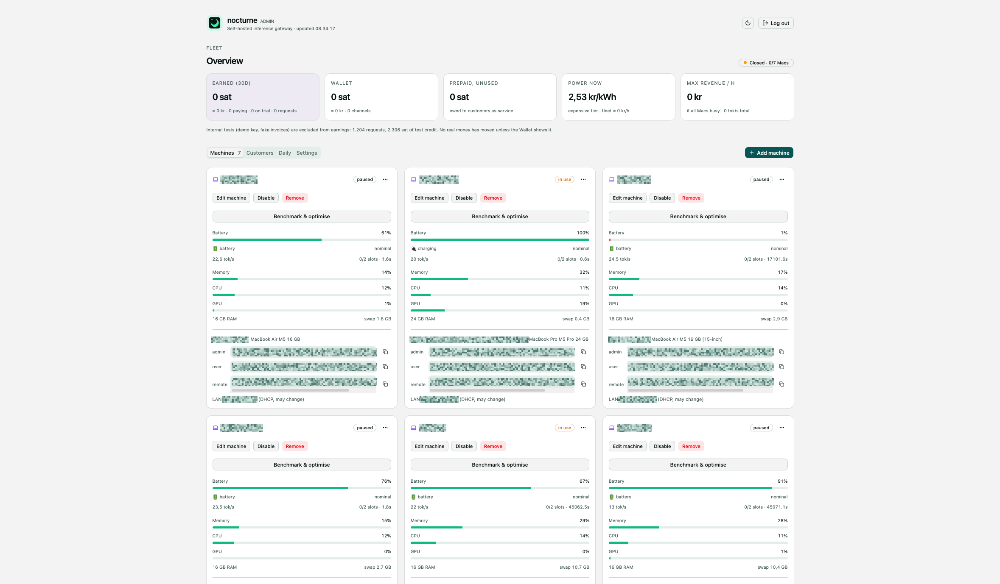

<div align="center">
  
</div>

<h1 align="center">Nocturne</h1>

<p align="center">An OpenAI-compatible API powered by idle Apple Silicon Macs, with per-request Lightning payments.</p>

<p align="center">
  <a href="https://www.python.org/"></a>
  <a href="https://go.dev/"></a>
  <a href="https://vuejs.org/"></a>
  <a href="https://www.apple.com/mac/"></a>
  <a href="LICENSE"></a>
</p>

<p align="center">
  <a href="#quick-start">Quick start</a> ·
  <a href="#configuration">Configuration</a> ·
  <a href="#adding-a-mac">Add a Mac</a> ·
  <a href="#go-gateway">Go gateway</a> ·
  <a href="#security-notes">Security</a>
</p>

## Overview

Nocturne runs overnight inference on idle Macs. A small gateway coordinates workers, meters token usage, and manages prepaid credit through Lightning. Prototype in daily use on a handful of Macs; **Python is the default runtime**, with an opt-in Go gateway for offline evaluation.

One small coordinator (the **gateway**) takes requests and hands each one to a single idle Mac (a **worker**). Each request runs entirely on one Mac; there is no tensor parallelism. Macs only work inside a night window, when nobody is using them, when they are cool, and when they are on the charger or have enough battery.



```
clients ──HTTPS──> gateway :8700 (public API)
                   gateway :8701 (workers, via SSH tunnel) <── Mac: worker agent + llama-server
                   gateway :8702 (admin view, private)
```

## Documentation

| Guide | Covers |
|---|---|
| [Quick start](#quick-start) | Local Python gateway, simulated workers, and user services |
| [Configuration](#configuration) | Request limits, schedules, pricing, and secret storage |
| [Adding a Mac](docs/mac-setup.md) | Portable owner config, key provenance, trusted bootstrap, verification and rollback |
| [Admin dashboard](web/README.md) | Vue development, local mock mode, and production builds |
| [Admin API](docs/admin-api.md) | Machine management, authentication, and ledger access |
| [Lightning backend decision](docs/lightning-backend-decision.md) | Payment backend selection and operational constraints |
| [Go gateway](#go-gateway) | Opt-in builds, runtime differences, and rollback |
| [Offline Python/Go comparison](docs/shadow-comparison.md) | Isolated HTTP parity checks, coverage, and known differences |

## Repository layout

| Path | Responsibility |
|---|---|
| [`gateway/`](gateway/) | Python coordinator: public, worker, and admin APIs; SQLite billing, Lightning, energy rules, and FX |
| [`go/`](go/) | Opt-in Go gateway and tunnel-key CLI; Python remains the default |
| [`worker/`](worker/) | Mac agent, safety sensors, setup, bootstrap, and launchd services |
| [`web/`](web/) | Vue 3 + TypeScript + shadcn-vue admin dashboard, built to `web/dist` and served at `/admin` |
| [`client/nbclient.py`](client/nbclient.py) | Standard-library client for low-priority overnight bulk jobs |
| [`simworker/`](simworker/) | Simulated workers for local tests and demos |
| [`tools/`](tools/) | Tunnel-key synchronization and offline Python/Go HTTP comparison |
| [`systemd/`](systemd/) | User units for the Python gateway, opt-in Go gateway, and tunnel-key sync |
| [`tests/`](tests/) | Python gateway, machine registry, energy, and phoenixd tests; Go tests live alongside their packages |

## Features

- OpenAI-compatible `/v1/chat/completions` (streaming and non-streaming), `/v1/models`, `/v1/status`.
- Prepaid API keys, open signup with trial credit, per-IP and per-key limits.
- Pricing set in a fiat currency per 1M tokens, charged in msat at a live BTC rate.
- Lightning invoices through phoenixd (signed webhooks), or a fake backend for development.
- Electricity-price rule: refuse paid work only when power costs more than a margin of the price.
- **Bulk lane**: your own jobs run behind paying customers, never on a Mac's last free slot.
- Safety per Mac: night window, idle detection, thermal state, battery floor (stops at 20%, restarts above 25%). Any user activity stops new work.
- Admin view (tailnet-only): earnings, wallet, power price, and a card per Mac with status, battery, tokens/s, memory/CPU/GPU load, owner and copyable SSH commands.

## Quick start

This is a general-purpose self-hosted project. Local development needs Python
3.12+, [uv](https://docs.astral.sh/uv/), and (for the dashboard) Bun. Go 1.26+
is needed only for the opt-in Go gateway. No wallet, Tailscale, Mac worker or
privileged installer is needed for the disposable local demo below.

```sh
uv sync --locked
cp config.example.json config.json
# Explicitly disable real payments. Also make the simulator window all-day UTC.
uv run python - <<'PYCONFIG'
import json
from pathlib import Path
p = Path('config.json')
c = json.loads(p.read_text())
c['lightning'] = {'backend': 'fake', 'min_msat': 1000, 'max_msat': 100000000, 'expiry_s': 3600}
c['schedule'] = {'tz': 'UTC', 'start': '00:00', 'end': '23:59', 'grace_min': 0}
c['public_base_url'] = 'http://127.0.0.1:8700'
p.write_text(json.dumps(c, indent=2) + '\n')
p.chmod(0o600)
PYCONFIG
uv run python setup_data.py
uv run pytest -q
(cd web && bun install --frozen-lockfile && bun run build)
SERVICE_ROOT=. uv run python -m gateway
```

Run in a second terminal from this checkout:

```sh
uv run python -m simworker.sim --workers 3 --script demo
# Bootstrap admin auth locally; do not paste this token in logs or issue reports.
curl -fsS -H "Authorization: Bearer $(cat data/admin-secret.txt)" \
  http://127.0.0.1:8702/admin/config
curl -fsS -H "Authorization: Bearer $(cat data/demo-api-key.txt)" \
  http://127.0.0.1:8700/v1/models
```

Open `http://127.0.0.1:8702/admin` and enter the secret from
`data/admin-secret.txt`. The dashboard uses a Bearer header, not a URL token.
`setup_data.py` initializes **demo-only** data, including a funded demo key and
simulator secrets; do not reuse it for production provisioning. It is intentionally
not a credential recovery tool for an existing data directory. The `demo` script
simulates battery changes; only its third worker remains continuously safe. The
window above has a one-minute midnight gap. Actual generation also depends on
energy policy/price availability. Never remove safety checks to force a demo.

Missing `web/dist` produces an explicit 503 at `/admin`; neither gateway builds
or embeds the dashboard. See [frontend development](web/README.md), including
mock mode. Vite development is separate from the backend; its existing proxy does
not yet include `/admin/config`. Configuration editing UI is not implemented yet.

**Network boundary:** expose only **8700** publicly behind TLS. Keep **8701**
(workers) and **8702** (admin) private. Local direct admin access requires the
secret; when using a trusted Tailscale proxy, `admin_tailnet_logins` must also
contain your identity. Never forward spoofable Tailscale identity headers from
untrusted clients. Stop the gateway with Ctrl-C and delete disposable config/data
when finished, not any production directory.

<details>
<summary>Install Python gateway and tunnel-key sync as user services</summary>


As user services (checkout at `~/nocturne`):

```sh
(cd web && bun install --frozen-lockfile && bun run build)   # admin UI -> web/dist
mkdir -p ~/.config/systemd/user
cp systemd/nocturne-gateway.service systemd/nocturne-tunnel-keys.service systemd/nocturne-tunnel-keys.path ~/.config/systemd/user/
systemctl --user daemon-reload
systemctl --user enable --now nocturne-gateway nocturne-tunnel-keys.path
```

`nocturne-tunnel-keys.path` watches `data/machines.json` and runs `tools/sync-tunnel-keys.py`, which writes the worker tunnel keys into a managed block of `~/.ssh/authorized_keys`, each restricted to forwarding `127.0.0.1:8701` with no shell. The gateway itself has no write access to `~/.ssh`. Keep a second way in (console or another key) the first time you enable it.

</details>

## Configuration

`config.json` (not committed; start from `config.example.json`). The main keys:

| Key | Meaning |
|---|---|
| `model` | Model alias workers must serve (must match `--alias` on llama-server) |
| `max_context`, `max_input_chars`, `max_tokens`, `request_timeout_s` | Request limits |
| `schedule` | `tz`, `start`, `end`, `grace_min`: the night window |
| `energy` | Price area/source, `tariff_dkk_per_kwh`, `watts_per_worker`, `reserve_margin`, `input_cost_weight`, `bulk_max_dkk_kwh` |
| `lightning` | `backend` (`phoenixd` or `fake`), `base_url`, invoice limits and expiry |
| `open_signup`, `trial_credit_msat`, `trials_per_day`, `signup_per_ip_per_day`, `signup_invite` | Signup |
| `bulk_keys`, `bulk_slots_per_worker`, `bulk_queue_depth` | Bulk lane |
| `internal_keys` | Keys whose spend is not counted as earnings (tests, demo) |
| `admin_tailnet_logins` | Tailscale logins allowed on the admin app |
| `public_base_url` | Public URL shown in docs and invoices |

Do not put wallet passwords or bearer credentials in `config.json`. The legacy
`signup_invite` field is itself access-sensitive: replace the example placeholder
or disable invitation-based use; never return it through the settings API. They live in `data/` (mode 0700, files 0600): hashed API keys and ledger (`ledger.sqlite`), the machine registry `machines.json` (worker secret SHA-256 digests, tunnel public keys, owner/SSH info), `admin-secret.sha256`. On first start an old `worker_secrets.json` and `config.macs` are migrated into `machines.json` once. phoenixd passwords are read from `~/.phoenix/phoenix.conf` at startup.

### Admin configuration and restart semantics

Both Python and Go runtimes support `GET /admin/config` and a revision-checked
`PATCH /admin/config` for **nonsecret allowlisted settings only**. Currently:

| Setting | Type / validation | Application |
|---|---|---|
| `service_name` | Printable string, 1-80 characters, no HTML metacharacters | Live after durable save |
| `public_limit_concurrency` | Integer 1-4096, not boolean | Saved now, effective on gateway restart |

Responses contain typed capability metadata, saved `values`, runtime `effective`
values, an opaque `revision` and `restart_required` field names. Other config,
including invitation values, login allowlists, credential references and unknown
extensions, is never returned. See [API contract](docs/admin-api.md#configuration-python-runtime).
The snapshot identifies its runtime as `python` or `go`. The settings screen and its Vite
proxy wiring remain follow-up work; do not assume API support implies UI support.

All other settings still require an operator file edit and gateway restart; some
worker settings also require separately updating worker services. Stop the
coordinator before manual config edits. Do not run multiple writers or share a
config/data directory between runtimes. Atomic saves preserve unknown settings,
use mode 0600, fsync the file and containing directory, and do not pretend that
restart-required settings changed running listeners. Back up config and data
securely before production changes; secrets must not enter git or screenshots.

### Before production

The demo is not a production installer. Use fresh private data and credentials,
review signup/trial limits, configure an explicit invoice-only payment adapter,
TLS, reverse-proxy trust/header stripping, backups and recovery, OS firewall and
worker-owner consent. Inspect each service unit and its checkout path before
copying/enabling that exact unit. Do not enable every `nocturne*` unit: Python
and Go must never run together on the same ports/data. No automatic service
installation or restart is provided by the settings API.

## Adding a Mac

Tested on MacBook Air M5 16 GB and MacBook Pro M5 Pro 24 GB, macOS 26, with Ornith-1.5-9B Q4_K_M (about 26 tokens/s per request with MTP speculative decoding).

Follow the complete [portable Mac setup guide](docs/mac-setup.md). Canonical owner
entry point: [`worker/nocturne-mac-setup.sh`](worker/nocturne-mac-setup.sh), with
[`worker/mac-setup.example.json`](worker/mac-setup.example.json). Configure your
own gateway, identity and verified public key files; check with `--check` first.
Owner prep changes only its managed owner SSH key block, never hidden admin users,
sudo, sleep or update policies. Privileged worker bootstrap/launchd installation
is a **separate**, approved stage from a reviewed root-owned package; never run
installers from `/tmp` or an owner/worker-writable checkout. Service installation
requires explicit `NOCTURNE_COORDINATOR_HOST`, `NOCTURNE_COORDINATOR_USER` and
verified `NOCTURNE_COORDINATOR_HOSTKEY`. Reference model/window/port choices still
need deployment-specific review. In **Add machine**, paste setup output in the
visible box, then **Parse → review → Apply → Save**. Existing DIGEST/PUBKEY
registration output remains supported. Older `nocturne mac report` output can
prefill its explicit owner/machine facts, but contains no worker registration
credentials; the current owner helper no longer emits that legacy report.
Import reports and registration output separately. Applying never overwrites
conflicting manual values or saves automatically; see the guide's
[legacy report import](docs/mac-setup.md#import-an-older-owner-system-report).
See the guide for prerequisites, key roles, verification, reruns and uninstall.

<details>
<summary>Tested llama-server settings and memory limits</summary>

llama-server flags used: `--ctx-size 65536 --parallel 2 -ctk q8_0 -ctv q8_0 -fa on -ngl 999 --reasoning-format deepseek --spec-type draft-mtp --spec-draft-n-max 2`. Bigger settings swapped or crashed on 16 GB.

</details>

## Bulk lane client

```python
import sys; sys.path.insert(0, 'client')
import nbclient as nb   # NOCTURNE_URL defaults to http://127.0.0.1:8700
cl = nb.Client('~/.config/nocturne/bulk.key', nb.Stats())
print(cl.chat('demo', [{'role': 'user', 'content': 'Summarise: ...'}], max_tokens=400, effort='low'))
```

`nb.run_adaptive(fn, items)` runs one request per Mac that is online (re-checked every minute) and stops at 07:30 Europe/Copenhagen (`TZ` in the file). Retries 429/503 with backoff.

## Security notes

- All three apps bind 127.0.0.1. Public traffic only reaches 8700 through your reverse proxy/Funnel; worker and admin routes return 404 there.
- Public 8700 has capped body size, header/body deadlines, method/path allowlist, per-IP limits, no CORS wildcard and no server banner.
- Worker tunnel keys can only forward to 127.0.0.1:8701. Worker secrets are generated on the Mac; only digests are stored on the coordinator.
- Ledger writes are transactional (SQLite WAL, synchronous=FULL); invoice credit and final settlement are idempotent.
- The systemd unit sets `IPAddressDeny`, but user-level systemd cannot enforce IP firewalls. Treat application-level loopback binds as the real boundary.
- Token counts come from the backend and are capped against output size; there is no gateway tokenizer.
- Never commit `data/`, `config.json`, phoenixd files or seed words.

## License

Copyright (C) 2026 Lucas Hanson. Licensed under the GNU Affero General Public
License, version 3 or (at your option) any later version (`AGPL-3.0-or-later`);
see [LICENSE](LICENSE). If you run a modified version as a network service,
you must offer its source to its users. This project license does not claim
rights in separately licensed third-party components.

The project and its purchase service: [lucashanson.dk/nocturne](https://lucashanson.dk/nocturne).

## Keeping secrets out of git

- `.gitignore` blocks `data/`, `config.json`, keys, `.sqlite`/`.db`, phoenixd files, logs and backups. Only `config.example.json` is tracked.
- Enable the pre-commit hook once per clone: `git config core.hooksPath .githooks`. It refuses runtime files and runs [gitleaks](https://github.com/gitleaks/gitleaks) on staged changes.
- CI (`.github/workflows/secrets.yml`) runs a pinned, checksum-verified gitleaks over the full history on every push and PR.


## Go gateway

**Opt-in only — not a live migration.** Python remains the default and rollback runtime. No deployment, wallet calls, service replacement, or live data migration is performed by the Go build targets. [Offline Python/Go comparison](docs/shadow-comparison.md) documents representative coverage and known differences; full shadow comparison and independent review remain release gates.

**Never run both coordinators against the same data directory or ports.** Back up the complete data directory before evaluation: startup recovers the ledger and modifies even an offline copy. Use isolated test configuration, not production credentials; maintenance can contact configured payment backends.

```sh
make go-build                         # native binary, requires Go
make go-linux-amd64                   # CGO_ENABLED=0 static Linux/amd64
SERVICE_ROOT=/path/to/offline-copy ./bin/nocturne serve
```

Build the [Vue admin UI](web/README.md#build) separately; assets are not embedded in the Go binary.

<details>
<summary>Runtime files, startup behavior, and graceful shutdown</summary>


`SERVICE_ROOT` defaults to `.`. The Go runtime reads `config.json`,
`data/prices.json`, `data/admin-secret.sha256`, the existing SQLite ledger and
`data/machines.json`, with the same legacy `api_keys.json`, worker secrets and
`config.macs` import conventions as Python. `NOCTURNE_AUTHORIZED_KEYS` overrides
legacy tunnel-key discovery (otherwise `~/.ssh/authorized_keys`). Startup opens
and recovers the ledger, releasing abandoned reservations, and reprices using
cached FX or the configured fallback before accepting requests. This modifies
an offline copy too: back up the complete data directory before any evaluation.
There is no automatic live migration or concurrent shadow ledger writing.
Relative Lightning credential paths are relative to the working directory, as
in Python; Phoenix `~/` expansion is retained. Assets are read-only files under
`SERVICE_ROOT/gateway` and `SERVICE_ROOT/web/dist`, not embedded in the binary.
Missing public assets or missing admin index return 503; missing individual
admin assets return 404. Build the Vue UI separately if required.

The listeners remain `127.0.0.1:8700/8701/8702`. One shared billing, machine
registry, energy, FX, worker coordinator, payment adapter and app own all routes.
Energy/FX refresh, invoice polling and worker sweeps share cancellation with HTTP
requests. SIGINT/SIGTERM stops admission, cancels work, drains HTTP for up to ten
seconds and closes SQLite after maintenance exits. All outbound transports ignore
proxy environment variables (`Proxy=nil`); no wallet is contacted at construction.
Maintenance and explicit invoice/admin calls can contact configured backends once
running, so do not start against production credentials during offline evaluation.

</details>

<details>
<summary>Security and compatibility differences from Python</summary>


Security deviations from Python:

- `lightning.backend` is mandatory, including explicit `fake` for isolated tests.
  Missing/unknown values fail closed, never silently falling back to fake.
- Malformed config, duplicate object keys, null values, wrong field types, invalid schedule/timezone,
  non-positive request/admission limits, invalid invoice ranges and negative
  trial credit fail before listening. Optional positive limits use Python defaults
  only when absent, not when explicitly zero. Startup errors are sanitized and
  never include config values or credential contents. Unknown fields are retained
  as ignored compatibility extensions, like Python.
- Admin digest must be a regular mode-0600 file with 64 lowercase hex characters.
  Adapter credential/TLS files require 0600; LNbits/LND require HTTPS and Phoenix
  is restricted to its private loopback endpoint. Existing tailnet login checks
  and Lightning route restrictions remain in place.
- Go omits framework-generated worker/admin API documentation and Python's
  optional invoice QR SVG. See `go/internal/app/doc.go` for route-level deviations.
- Live pricing snapshots and energy FX updates are synchronized for Go's
  concurrent request model. Request logs retain `request_id=` correlation.

</details>

<details>
<summary>Opt-in services, rollback, and tunnel-key helper</summary>


The supplied `systemd/nocturne-gateway-go.service` is **opt-in**. Inspect/copy it
explicitly only after those release gates, then stop Python before starting Go.
It executes `%h/nocturne/bin/nocturne serve`; the original Python unit is unchanged.
Rollback means stop Go, restore the backed-up data if needed, and start the
original `nocturne-gateway.service`. Do not enable both units.
The original tunnel-key path/service continues using Python independently, with
its existing SSH-only write scope. If deliberately switching that helper later,
use a user-unit override changing only `ExecStart` to
`%h/nocturne/bin/nocturne sync-tunnel-keys` (clear the old `ExecStart` first), and
retain all existing sandbox/permissions and the path watcher. Go does not modify
or install that override. Neither gateway gets SSH write permission.

</details>
